 

 

 

## Epochix

*Visual storytelling for deep learning training runs.*

See what your model is actually doing: training logs become a plain-English story with a letter grade, live in VS Code.

 

## safescreen

**Your screen goes dark when you look away.**

Not a lock screen. Your webcam checks where you're looking and who's behind you, and the screen goes black the moment it matters. Everything runs locally: no network, no telemetry, no account.

 

### 🛠️ Featured projects

| Project | What it does | Stars |
|:--|:--|:--:|
| [`Epochix`](https://github.com/Epochix-dev/epochix) | Visual storytelling for deep learning training runs. Turns training logs into animated plain-English narratives. |  |
| [`safescreen`](https://github.com/kv4u/safescreen) | Open-source privacy screen for Windows. Blacks out when you look away or someone shoulder surfs. |  |
| [`MoveZ`](https://github.com/kv4u/MoveZ) | Move AI coding sessions between Cursor, Windsurf, Claude Code, Codex, Copilot CLI and Cline. |  |
| [`SaRa`](https://github.com/kv4u/SaRa) | ADHD-friendly focus app with micro-tasks, timers and gentle encouragement. |  |
| [`GymMaster`](https://github.com/kv4u/GymMaster) | Gym workout timer app built with Flutter. |  |

 

&nbsp;&nbsp;&nbsp;

  

 

powered by coffee, Claude Code, and way too many commits

 

 

 

## Epochix

*Visual storytelling for deep learning training runs.*

See what your model is actually doing: training logs become a plain-English story with a letter grade, live in VS Code.

 

## safescreen

**Your screen goes dark when you look away.**

Not a lock screen. Your webcam checks where you're looking and who's behind you, and the screen goes black the moment it matters. Everything runs locally: no network, no telemetry, no account.

 

### 🛠️ Featured projects

| Project | What it does | Stars |
|:--|:--|:--:|
| [`Epochix`](https://github.com/Epochix-dev/epochix) | Visual storytelling for deep learning training runs. Turns training logs into animated plain-English narratives. |  |
| [`safescreen`](https://github.com/kv4u/safescreen) | Open-source privacy screen for Windows. Blacks out when you look away or someone shoulder surfs. |  |
| [`MoveZ`](https://github.com/kv4u/MoveZ) | Move AI coding sessions between Cursor, Windsurf, Claude Code, Codex, Copilot CLI and Cline. |  |
| [`SaRa`](https://github.com/kv4u/SaRa) | ADHD-friendly focus app with micro-tasks, timers and gentle encouragement. |  |
| [`GymMaster`](https://github.com/kv4u/GymMaster) | Gym workout timer app built with Flutter. |  |

 

&nbsp;&nbsp;&nbsp;

  

<picture>
  <source media="(prefers-color-scheme: dark)" srcset="https://raw.githubusercontent.com/kv4u/kv4u/output/github-snake-dark.svg" />
  
</picture>

 

powered by coffee, Claude Code, and way too many commits

